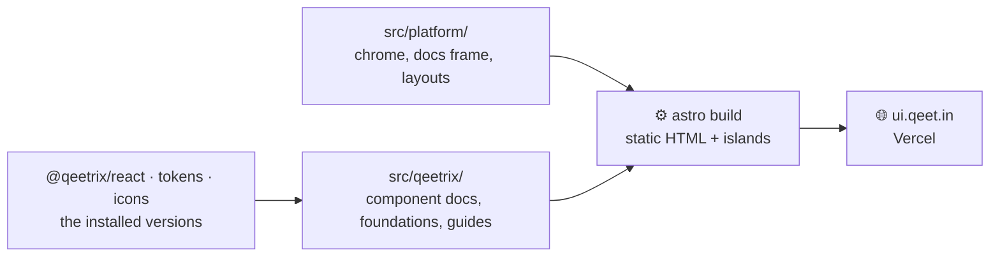

<div align="center">

# 📘 Qeetrix Docs

**[ui.qeet.in](https://ui.qeet.in): the documentation of Qeetrix, the Qeet Group design system, on Qeet's own docs
platform.**

[](https://astro.build)
[](https://www.npmjs.com/package/@qeetrix/react)
[](#-whats-inside)
[](https://ui.qeet.in)

[🌐 ui.qeet.in](https://ui.qeet.in) · [🛠️ Develop](#-develop) · [🗂️ Layout](#-layout) · [🧩 A component's page](#-a-components-page) · [🤝 AGENTS.md](AGENTS.md)

</div>

## 📦 What's inside

| | |
|:--|:--|
| 📄 **Static pages** | Astro 7: a reading page ships no React. Live examples and the home page's demos are islands, loaded only where they're used |
| 🧩 **Every component** | Each with five tabs: usage, examples (with a live playground), API, accessibility and changelog |
| 🎨 **Built from Qeetrix** | `@qeetrix/react`, `@qeetrix/tokens` and `@qeetrix/icons`, styled with tokens in plain CSS; no Fumadocs, no Tailwind |
| 🔎 **Search and AI-ready** | Qeetrix's SiteSearch over a build-time index, plus `llms.txt`, `llms-full.txt` and every page as Markdown |
| ♻️ **A reusable platform** | The product-agnostic parts in `src/platform/`, ready for other Qeet products' docs |

## 🔗 How it fits



## 🛠️ Develop

```sh
npx -y bun@1.3.14 install   # CI's Bun: a newer one rewrites the lockfile CI can't read
bun run dev                 # http://localhost:3007
bun run build               # the static site, in dist/
bun run components          # after adding a component: its registry entry and route
```

Before every push, run the whole gate (Biome, the types, the build and the audit): the one command is in
[AGENTS.md](AGENTS.md), with the rules every page follows.

## 🗂️ Layout

```text
src/
├── platform/      the product-agnostic platform: chrome (header, search, footer, theme menu), the docs frame,
│                  layouts, motion, styles, and the SiteChrome / DocsChrome contract a product fills in
├── qeetrix/       the Qeetrix docs: one folder per component, foundations, icons, guides, the home page's islands,
│                  site.ts (every link, the navigation, the footer), and the counts and versions read at build time
├── pages/         the routes, plus llms.txt, llms-full.txt and search-index.json, written from the component docs
└── content/       the docs collection, checked against the page schema
```

## 📐 Rules

- **Tokens only:** every colour, size, radius, shadow and duration is a `var(--qx-*)`.
- **Cascade layers, not `!important`:** `qx.base, qx.components, platform, product`, restated on each stylesheet's
  first line, since Astro bundles CSS in import order.
- **Server first:** a component renders to HTML at build time; it becomes an island only when it must respond in the
  browser.
- **The colour scheme belongs to `<html>`:** a pre-paint script sets it; islands' `QeetrixProvider` sets locale and
  direction only.
- **Every claim is checked** against the installed packages: props against their types, parts against the DOM.

## 🧩 A component's page

Each component is a folder in `src/qeetrix/components/`: `doc.tsx` (its facts, usage, API, accessibility and
changelog), `examples.tsx` (the real component with each example's code), `Playground.tsx` and, when its examples need
React, `Live.tsx`. Add a row to `scripts/components.ts` and run `bun run components`: the five tabs, the category
page, the search index and `llms-full.txt` follow.

## 🚢 Releases

Work lands on `develop`. A pull request from `develop` into `main` with the version raised in `package.json`
deploys it: merging builds the site, deploys it to Vercel production and tags `vX.Y.Z`. `rollback.yml` redeploys an
earlier tag. The old Next.js site's `/docs/…` addresses redirect to the new pages (`vercel.json`).
